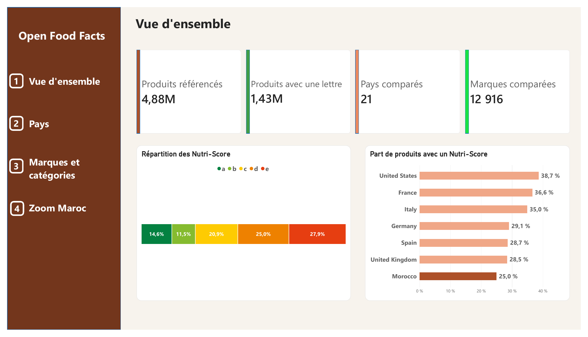
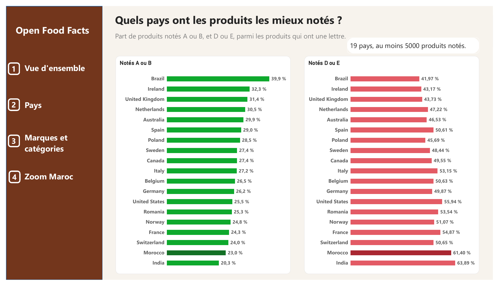
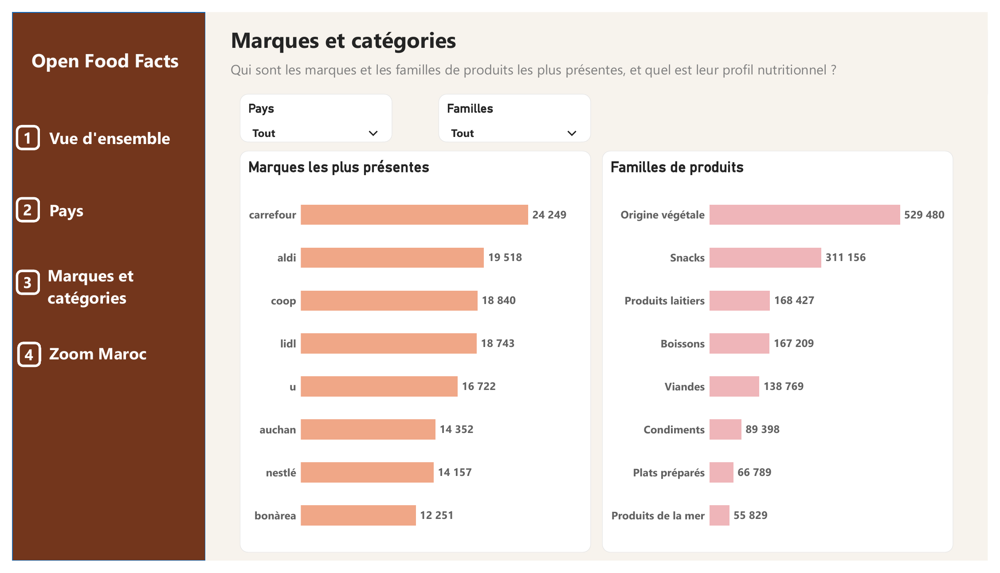
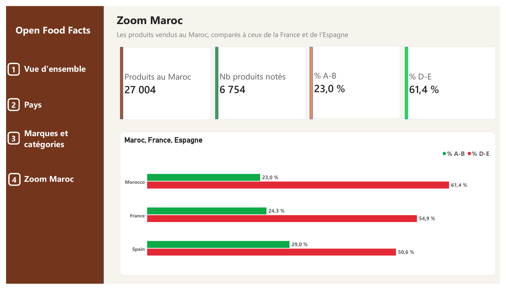
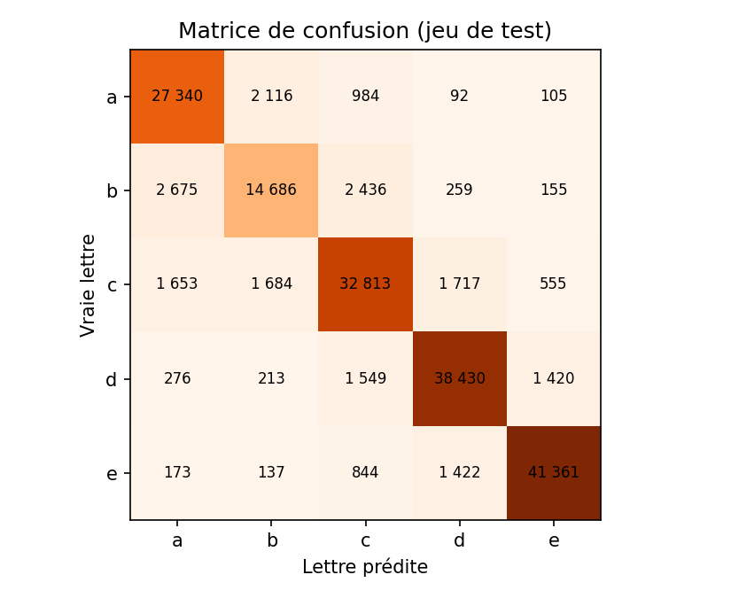
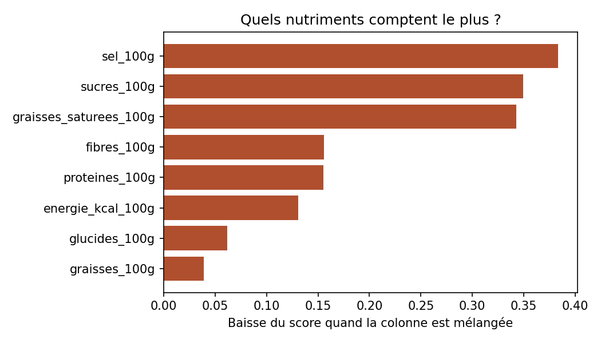

# Pipeline de données Open Food Facts : de la donnée brute au Nutri-Score

 

Projet personnel de bout en bout sur **4,9 millions de produits alimentaires** : chargement dans BigQuery, nettoyage, modèle en étoile, tests de qualité avec dbt, tableau de bord Power BI et modèle de prédiction du Nutri-Score.

**Question de départ :** quels pays, quelles marques et quelles familles de produits ont les meilleurs Nutri-Score, et peut-on prédire la lettre d'un produit à partir de sa table nutritionnelle ?

> Les données décrivent les produits **référencés par les contributeurs d'Open Food Facts**, pas ce que mangent les habitants d'un pays.

---

## Résultats en bref

| | |
|---|---|
| Produits après nettoyage et dédoublonnage | **4 882 099** |
| Produits avec un Nutri-Score (lettre a à e) | **1 432 366** (29,3 %) |
| Pays comparés (au moins 25 000 produits) | 21 |
| Marques comparées (au moins 30 produits) | 12 916 |
| Tests de qualité dbt | 15 (tous réussis) |
| Précision du modèle sur des produits jamais vus | **88,3 %** (référence : 25,1 %) |

**Le Maroc en un coup d'œil** : 27 004 produits référencés, dont 6 754 ont une lettre (25,0 %). Parmi ces derniers, 23,0 % sont notés A ou B et 61,4 % sont notés D ou E, contre 24,3 % et 54,9 % en France, et 29,0 % et 50,6 % en Espagne. Le Maroc se place 18ᵉ sur 19 pays pour la part de produits A ou B.

---

## Architecture

```
Export Open Food Facts (Parquet)
        │
        ▼
 DuckDB (exploration locale)  ──►  BRONZE  (BigQuery, table brute allégée)
                                      │
                                      ▼  dbt
                                   SILVER  (produits nettoyés, un produit par code)
                                      │
                                      ▼  dbt
                                    GOLD   (modèle en étoile)
                                   ┌──┴───────────────┐
                                   ▼                  ▼
                              Power BI          Modèle ML (scikit-learn)
```

| Couche | Contenu | Outil |
|---|---|---|
| **Bronze** | Données brutes, avec seulement les colonnes utiles (8 nutriments) pour tenir dans le quota gratuit de BigQuery | Python, BigQuery |
| **Silver** | Nom, marque, catégories, pays, Nutri-Score et nutriments nettoyés, valeurs aberrantes écartées, doublons de code supprimés | dbt |
| **Gold** | Modèle en étoile : `fait_produit_pays` (un produit par pays) et `dim_pays`, `dim_marque`, `dim_categorie`, `dim_produit` | dbt |


---

## Qualité des données

Les problèmes rencontrés, et ce qui a été fait :

- **Codes en double** : 61 codes apparaissaient plusieurs fois avec des lignes différentes. Dans silver, on garde pour chaque code la ligne la plus complète.
- **Valeurs impossibles** : les nutriments hors bornes plausibles sont mis à `NULL`.
- **Pays « world »** : retiré, ce n'est pas un pays.
- **Étiquettes de pays en double** : les contributeurs saisissent parfois le pays en français (« Etats Unis »), à côté de l'étiquette officielle (« United States »). Ces étiquettes à part ne regroupent que quelques produits. Pour les analyses, on ne garde que les pays ayant au moins 25 000 produits (colonne `pays_retenu`). **Ces doublons ne sont pas fusionnés dans silver : c'est une limite connue.**
- **Nutri-Score absent** : 70 % des produits n'ont pas de lettre. Les statistiques par lettre portent uniquement sur les produits notés.

**15 tests dbt** vérifient à chaque exécution : unicité des clés, valeurs non nulles, valeurs autorisées pour la lettre (a à e) et relations entre la table de faits et les dimensions. `dbt build` : 6 modèles et 15 tests, tous réussis.

Une vérification automatique (GitHub Actions) lance `dbt parse` à chaque modification du projet dbt, pour détecter toute erreur d'écriture ou de référence entre modèles.

---

## Tableau de bord Power BI

Quatre pages : vue d'ensemble, comparaison des pays, marques et catégories, zoom sur le Maroc. Les mesures (nombre de produits, part de A ou B, part de D ou E) sont écrites en DAX.

| Vue d'ensemble | Pays |
|---|---|
|  |  |

| Marques et catégories | Zoom Maroc |
|---|---|
|  |  |

Le fichier `.pbix` n'est pas versionné ; les captures ci-dessus montrent le résultat.

---

## Modèle de prédiction du Nutri-Score

**Objectif :** deviner la lettre (a à e) d'un produit à partir de 8 nutriments pour 100 g : énergie, graisses, graisses saturées, glucides, sucres, fibres, protéines, sel.

**Données :** 875 472 produits ayant une lettre et les 8 nutriments renseignés. Séparation 80 % entraînement (700 377) et 20 % test (175 095), avec les mêmes proportions de lettres dans les deux.

| Modèle | Précision sur le test |
|---|---|
| Toujours répondre « E » (référence) | 0,251 |
| Arbre de décision, profondeur 20 | 0,868 |
| Gradient boosting, 300 arbres | 0,860 |
| **Gradient boosting, 500 arbres, 127 feuilles** | **0,883** |

Par lettre, pour le meilleur modèle :

| Lettre | Précision | Rappel |
|---|---|---|
| a | 0,851 | 0,892 |
| b | 0,780 | 0,727 |
| c | 0,850 | 0,854 |
| d | 0,917 | 0,917 |
| e | 0,949 | 0,941 |

Les erreurs se font presque toujours entre lettres voisines (A et B, D et E). Entre A et E, on compte moins de 300 erreurs sur 175 095 produits. La lettre B est la plus difficile.




**Les nutriments les plus utiles au modèle** sont le sel, les sucres et les graisses saturées, qui sont aussi les principaux éléments défavorables de la formule officielle.

### Limite importante

Le Nutri-Score est **calculé par une formule** à partir des nutriments. Un bon score signifie donc que le modèle a en grande partie **retrouvé cette formule**, pas qu'il a découvert une relation nouvelle. Il n'atteint pas 100 % parce que la formule utilise d'autres informations absentes de nos 8 colonnes (comme la part de fruits et légumes). L'intérêt pratique est d'estimer une lettre pour des produits qui n'en ont pas, avec une marge d'erreur connue.

---

## Reproduire le projet

1. Créer un environnement Python et installer les dépendances :
   ```
   python -m venv venv
   venv\Scripts\activate
   pip install -r requirements.txt
   ```
2. Se connecter à Google Cloud (compte avec un projet BigQuery) : `gcloud auth application-default login`
3. Placer l'export Open Food Facts au format Parquet dans `data/` (non versionné) et exécuter les notebooks `01` et `02` pour charger la couche bronze dans BigQuery.
4. Configurer le profil dbt (`profiles.yml`, hors dépôt) puis, dans `off_dbt/` : `dbt build`
5. Exécuter `notebooks/05_ml_nutriscore.ipynb` pour le modèle.

Aucune clé ni identifiant n'est stocké dans le dépôt.

## Structure du dépôt

```
off_pipeline/
├── notebooks/        01 couverture · 02 bronze · 03 qualité silver · 04 analyses gold · 05 modèle ML
├── off_dbt/          modèles silver et gold, tests, macros
├── docs/             captures du tableau de bord, lignage dbt, graphiques du modèle
├── requirements.txt
└── README.md
```

## Outils

Python (pandas, scikit-learn, matplotlib) · DuckDB · Google BigQuery · dbt · Power BI (DAX) · Git et GitHub

## Source et licence des données

Données : [Open Food Facts](https://world.openfoodfacts.org), base collaborative sous licence ODbL. Merci à ses contributeurs.
